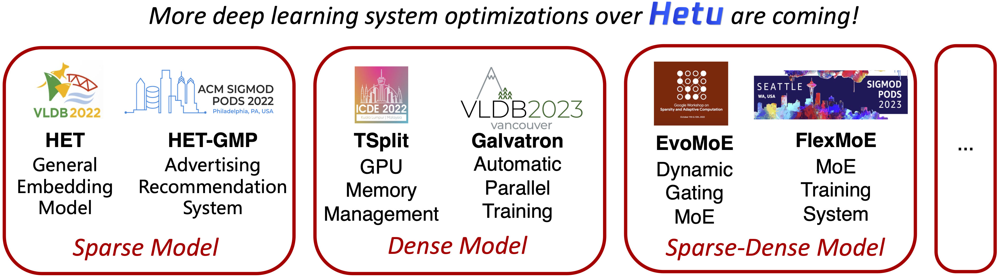

<div align=center>

</div>

# HETU

<!--- [](LICENSE) --->

[Documentation](https://hetu-doc.readthedocs.io) | [Examples](https://hetu-doc.readthedocs.io/en/latest/Overview/performance.html)

Hetu is a high-performance distributed deep learning system targeting trillions of parameters DL model training, developed by <a href="https://cuibinpku.github.io" target="_blank" rel="nofollow">DAIR Lab</a> at Peking University. It takes account of both high availability in industry and innovation in academia. 

*This is the preview of Hetu 2.0, which is still under rapid development. Please raise an issue if you need any help.*

We welcome everyone interested in machine learning or graph computing to contribute codes, create issues or pull requests. Please refer to [Contribution Guide](CONTRIBUTING.md) for more details.

## Key Features

<div align=center>

</div>

## Installation
1. Clone the repository.

2. Prepare the environment. We use Anaconda to manage packages. The following command create the conda environment to be used:`conda env create -f environment.yml`. Please prepare Cuda toolkit, CuDNN, and gRPC in advance.

3. We use CMake to compile Hetu. Please copy the example configuration for compilation by `cp cmake/config.example.cmake cmake/config.cmake`. Users can modify the configuration file to enable/disable the compilation of each module. For advanced users (who not using the provided conda environment), the prerequisites for different modules in Hetu is listed in appendix.

```bash
# modify paths and configurations in cmake/config.cmake

# generate Makefile
mkdir build && cd build && cmake ..

# compile
# make hetu, version is specified in cmake/config.cmake
make -j 32
```

4. Prepare environment for running. Edit the hetu.exp file and set the environment path for python and the path for executable mpirun if necessary (for advanced users not using the provided conda environment). Then execute the command `source hetu.exp` .


## Community
* Email: ccchengff@pku.edu.cn, xupeng.miao@pku.edu.cn
* Click [here](https://join.slack.com/t/hetu-ai/shared_invite/zt-1kpanxc83-9YndNPZYDH9orbR6MeIMbg) to join our Slack community.
* Hetu homepage: https://hetu-doc.readthedocs.io
* [Committers & Contributors](COMMITTERS.md)
* [Contributing to Hetu](CONTRIBUTING.md)
* [Development plan](https://hetu-doc.readthedocs.io/en/latest/plan.html)


## Enterprise Users

If you are enterprise users and find Hetu is useful in your work, please let us know, and we are glad to add your company logo here.

* Tencent Inc.


* Alibaba Cloud.


* Kuaishou Tech.


## License

The entire codebase is under [license](LICENSE)

## Papers

We have proposed numerous innovative optimization techniques around the Hetu system and published several papers, covering a variety of different model workloads and hardware environments.

### Distributed DL System Design
  1. Haoyang Li, Fangcheng Fu, Hao Ge, Sheng Lin, Xuanyu Wang, Jiawen Niu, Xupeng Miao, Bin Cui. [Hetu v2: A General and Scalable Deep Learning System with Hierarchical and Heterogeneous Single Program Multiple Data Annotations](https://arxiv.org/abs/2504.20490). arXiv 2025 [[code]](https://github.com/PKU-DAIR/Hetu)
  2. Xupeng Miao, Xiaonan Nie, Hailin Zhang, Tong Zhao and Bin Cui. [Hetu: A highly efficient automatic parallel distributed deep learning system](https://link.springer.com/content/pdf/10.1007/s11432-022-3581-9.pdf). **SCIS 2022** [[code]](https://github.com/PKU-DAIR/Hetu/tree/hetu-v1.0)

### Transformer Model & Large Language Model
  3. Haoyang Li, Fangcheng Fu, Sheng Lin, Hao Ge, Xuanyu Wang, Jiawen Niu, Jinbao Xue, Yangyu Tao, Di Wang, Jie Jiang, Bin Cui. [Hydraulis: Balancing Large Transformer Model Training via Co-designing Parallel Strategies and Data Assignment](https://arxiv.org/abs/2412.07894). **SIGMOD 2026** [[code]](https://github.com/PKU-DAIR/Hetu/tree/main/examples/hydraulis)
  4. Sheng Lin, Fangcheng Fu, Haoyang Li, Hao Ge, Xuanyu Wang, Jiawen Niu, Yaofeng Tu, Bin Cui. [LobRA: Multi-tenant Fine-tuning over Heterogeneous Data](https://arxiv.org/abs/2509.01193). **VLDB 2025** [[code]](https://github.com/PKU-DAIR/Hetu/tree/main/examples/lobra)
  5. Yujie Wang, Shiju Wang, Shenhan Zhu, Fangcheng Fu, Xinyi Liu, Xuefeng Xiao, Huixia Li, Jiashi Li, Faming Wu, Bin Cui. [FlexSP: Accelerating Large Language Model Training via Flexible Sequence Parallelism](https://arxiv.org/abs/2412.01523). **ASPLOS 2025** [[code]](https://github.com/PKU-DAIR/Hetu-Galvatron/tree/flexsp)
  6. Yujie Wang, Shenhan Zhu, Fangcheng Fu, Xupeng Miao, Jie Zhang, Juan Zhu, Fan Hong, Yong Li, Bin Cui. [Spindle: Efficient Distributed Training of Multi-Task Large Models via Wavefront Scheduling](https://arxiv.org/abs/2409.03365). **ASPLOS 2025** 
  7. Hao Ge, Junda Feng, Qi Huang, Fangcheng Fu, Xiaonan Nie, Lei Zuo, Haibin Lin, Bin Cui, Xin Liu. [ByteScale: Communication-Efficient Scaling of LLM Training with a 2048K Context Length on 16384 GPUs](https://dl.acm.org/doi/10.1145/3718958.3754352). **SIGCOMM 2025**
  8. Hao Ge, Fangcheng Fu, Haoyang Li, Xuanyu Wang, Sheng Lin, Yujie Wang, Xiaonan Nie, Hailin Zhang, Xupeng Miao, Bin Cui. [Enabling Parallelism Hot Switching for Efficient Training of Large Language Models](https://dl.acm.org/doi/10.1145/3694715.3695969). **SOSP 2024** [[code]](https://github.com/PKU-DAIR/Hetu/tree/main/examples/hotspa)
  9. Yujie Wang, Youhe Jiang, Xupeng Miao, Fangcheng Fu, Xiaonan Nie, Bin Cui. [Improving Automatic Parallel Training via Balanced Memory Workload Optimization](https://arxiv.org/abs/2307.02031). **TKDE 2024** [[code]](https://github.com/PKU-DAIR/Hetu-Galvatron)
  10. Xupeng Miao, Shenhan Zhu, Fangcheng Fu, Ziyu Guo, Zhi Yang, Yaofeng Tu, Zhihao Jia, Bin Cui. [Reviving Efficient Attention for Long Context Language Modeling: A Survey](https://www.ijcai.org/proceedings/2024/0904.pdf). **IJCAI 2024** [[code]](https://github.com/Hsword/X-former-Elucidator)
  11. Xupeng Miao, Yujie Wang, Youhe Jiang,  Chunan Shi, Xiaonan Nie, Hailin Zhang, Bin Cui. [Galvatron: Efficient Transformer Training over Multiple GPUs Using Automatic Parallelism](https://arxiv.org/abs/2211.13878). **VLDB 2023** [[code]](https://github.com/PKU-DAIR/Hetu/tree/hetu-v1.0/tools/Galvatron)
  12. Youhe Jiang, Fangcheng Fu, Xupeng Miao, Xiaonan Nie and Bin Cui. [OSDP: Optimal Sharded Data Parallel for Distributed Deep Learning](http://arxiv.org/abs/2209.13258). **IJCAI 2023** [[code]](https://github.com/Youhe-Jiang/IJCAI2023-OptimalShardedDataParallel)

### Mixture-of-experts Model
  13. Xinyi Liu, Yujie Wang, Fangcheng Fu, Xupeng Miao, Shenhan Zhu, Xiaonan Nie, Bin Cui. [NetMoE: Accelerating MoE Training through Dynamic Sample Placement](https://openreview.net/forum?id=1qP3lsatCR). **ICLR 2025**
  14. Xiaonan Nie, Qibin Liu, Fangcheng Fu, Shenhan Zhu, Xupeng Miao, Xiaoyang Li, Yang Zhang, Shouda Liu, Bin Cui. [LSH-MoE: Communication-efficient MoE Training via Locality-Sensitive Hashing](https://nips.cc/Conferences/2024). **NeurIPS 2024**
  15. Xiaonan Nie,  Xupeng Miao, Zilong Wang,  Jilong Xue and Lingxiao Ma, Zichao Yang, Gang Cao, Bin Cui. [FlexMoE: Scaling Large-scale Sparse Pre-trained Model Training via Dynamic Device Placement](https://arxiv.org/abs/2304.03946). **SIGMOD 2023**
  16. Xiaonan Nie, Pinxue Zhao, Xupeng Miao, Tong Zhao, Bin Cui. [HetuMoE: An Efficient Trillion-scale Mixture-of-Expert Distributed Training System](https://arxiv.org/abs/2203.14685). arXiv 2022 [[code]](https://github.com/Hsword/Hetu/tree/main/examples/moe)
  17. Xiaonan Nie, Shijie Cao, Xupeng Miao, Lingxiao Ma, Jilong Xue, Youshan Miao, Zichao Yang, Zhi Yang, Bin Cui. [EvoMoE: An Evolutional Mixture-of-Experts Training Framework via Dense-To-Sparse Gate](https://arxiv.org/abs/2112.14397). arXiv 2021 [[code]](https://github.com/codecaution/EvoMoE)

### Embedding Model
  18. Hailin Zhang, Penghao Zhao, Xupeng Miao, Yingxia Shao, Zirui Liu, Tong Yang, Bin Cui. [Experimental Analysis of Large-scale Learnable Vector Storage Compression](https://arxiv.org/abs/2311.15578). **VLDB 2024** [[code]](https://github.com/Hsword/Hetu/tree/hetu-v1.0/tools/EmbeddingMemoryCompression)
  19. Hailin Zhang, Zirui Liu, Boxuan Chen, Yikai Zhao, Tong Zhao, Tong Yang, Bin Cui. [CAFE: Towards Compact, Adaptive, and Fast Embedding for Large-scale Recommendation Models](https://arxiv.org/abs/2312.03256). **SIGMOD 2024** [[code]](https://github.com/HugoZHL/CAFE)
  20. Xupeng Miao, Hailin Zhang, Yining Shi, Xiaonan Nie, Zhi Yang, Yangyu Tao, Bin Cui. [HET: Scaling out Huge Embedding Model Training via Cache-enabled Distributed Framework](https://arxiv.org/abs/2112.07221). **VLDB 2022 (Best Scalable Data Science Paper)** [[code]](https://github.com/Hsword/Het)
  21. Xupeng Miao, Yining Shi, Hailin Zhang, Xin Zhang, Xiaonan Nie, Zhi Yang, Bin Cui. [HET-GMP: a Graph-based System Approach to Scaling Large Embedding Model Training](https://dl.acm.org/doi/10.1145/3514221.3517902). **SIGMOD 2022** [[code]](https://github.com/Hsword/SIGMOD2022_HET-GMP)
  22. Sicong Dong, Xupeng Miao, Pengkai Liu, Xin Wang, Bin Cui, Jianxin Li. [HET-KG: Communication-Efficient Knowledge Graph Embedding Training via Hotness-Aware Cache](https://ieeexplore.ieee.org/document/9835364). **ICDE 2022**

### Hetetrogeneous/Dynamic/Decentralized Resources
  23. Xuanyu Wang, Fangcheng Fu, Haoyang Li, Hao Ge, Sheng Lin , Jiawen Niu, Bin Cui. [Elastor: Elastic and Efficient Model Partitioning and Checkpointing for Fault-tolerant Distributed Training](). **PPoPP 2026** [[code]](https://github.com/PKU-DAIR/Hetu/tree/main/examples/ampelos)
  24. Haoyang Li, Fangcheng Fu, Hao Ge, Sheng Lin, Xuanyu Wang, Jiawen Niu, Yujie Wang, Hailin Zhang, Xiaonan Nie, Bin Cui. [Malleus: Straggler-Resilient Hybrid Parallel Training of Large-scale Models via Malleable Data and Model Parallelization](https://arxiv.org/abs/2410.13333). **SIGMOD 2025** [[code]](https://github.com/PKU-DAIR/Hetu/tree/main/examples/malleus)
  25. Xupeng Miao, Yining Shi, Zhi Yang, Bin Cui, Zhihao Jia. [SDPipe: A Semi-Decentralized Framework for Heterogeneity-aware Pipeline-parallel Training](https://www.vldb.org/pvldb/vol16/p2354-miao.pdf). **VLDB 2023** [[code]](https://github.com/Hsword/VLDB2023_SDPipe)
  26. Xupeng Miao, Xiaonan Nie, Yingxia Shao, Zhi Yang, Jiawei Jiang, Lingxiao Ma, Bin Cui. [Heterogeneity-Aware Distributed Machine Learning Training via Partial Reduce](https://doi.org/10.1145/3448016.3452773). **SIGMOD 2021**

### Kernel Optimization
  27. Hailin Zhang, Xiaodong Ji, Yilin Chen, Fangcheng Fu, Xupeng Miao, Xiaonan Nie, Weipeng Chen, Bin Cui. [PQCache: Product Quantization-based KVCache for Long Context LLM Inference](https://arxiv.org/abs/2407.12820). **SIGMOD 2025** [[code]](https://github.com/HugoZHL/PQCache)
  28. Yifei Xia, Suhan Ling, Fangcheng Fu, Yujie Wang, Huixia Li, Xuefeng Xiao, Bin Cui. [Training-free and Adaptive Sparse Attention for Efficient Long Video Generation](https://openaccess.thecvf.com/content/ICCV2025/html/Xia_Training-free_and_Adaptive_Sparse_Attention_for_Efficient_Long_Video_Generation_ICCV_2025_paper.html). **ICCV 2025**
  29. Zihao Yu, Haoyang Li, Fangcheng Fu,  Xupeng Miao, Bin Cui. [Accelerating Text-to-image Editing via Cache-enabled Sparse Diffusion Inference](http://arxiv.org/abs/2305.17423). **AAAI 2024** [[code]](https://github.com/Hankpipi/Hetu/tree/diffusers)
  30. Xupeng Miao, Lingxiao Ma, Zhi Yang, Yingxia Shao, Bin Cui, Lele Yu, Jiawei Jiang. [CuWide: Towards Efficient Flow-based Training for Sparse Wide Models on GPUs](https://ieeexplore.ieee.org/document/9261124). **TKDE 2021, ICDE 2021** [[code]](https://github.com/Hsword/cuWide)

### Memory Management
  31. Pinxue Zhao, Hailin Zhang, Fangcheng Fu, Xiaonan Nie, Qibin Liu, Fang Yang, Yuanbo Peng, Dian Jiao, Shuaipeng Li, Jinbao Xue, Yangyu Tao, Bin Cui. [Memo: Fine-grained Tensor Management For Ultra-long Context LLM Training](https://arxiv.org/abs/2407.12117). **SIGMOD 2025** [[code]](https://github.com/pinxuezhao/MEMO)
  32. Xiaonan Nie, Yi Liu, Fangcheng Fu,  Jinbao Xue, Dian Jiao, Xupeng Miao, Yangyu Tao, Bin Cui. [Angel-PTM: A Scalable and Economical Large-scale Pre-training System in Tencent](http://arxiv.org/abs/2303.02868). **VLDB 2023**
  33. Xiaonan Nie, Xupeng Miao, Zhi Yang, Bin Cui. [TSplit: Fine-grained GPU Memory Management for Efficient DNN Training via Tensor Splitting](https://ieeexplore.ieee.org/document/9835178). **ICDE 2022** [[code]](https://github.com/codecaution/TSplit)

### Graph Neural Network
  34. Xupeng Miao, Yujie Wang, Jia Shen, Yingxia Shao, Bin Cui. Graph Neural Network Training Acceleration over Multi-GPUs. **Journal of Software (Chinese)**

### coming soon...

## Cite

If you use Hetu in a scientific publication, we would appreciate citations to the following papers:
```
@article{DBLP:journals/corr/abs-2504-20490,
  author  = {Haoyang Li and Fangcheng Fu and Hao Ge and Sheng Lin and Xuanyu Wang and Jiawen Niu and Xupeng Miao and Bin Cui},
  title = {Hetu v2: A General and Scalable Deep Learning System with Hierarchical and Heterogeneous Single Program Multiple Data Annotations},
  journal = {CoRR},
  volume = {abs/2504.20490},
  year = {2025}
}

@article{DBLP:journals/chinaf/MiaoXP22,
  author = {Miao, Xupeng and Nie, Xiaonan and Zhang, Hailin and Zhao, Tong and Cui, Bin},
  title = {Hetu: A highly efficient automatic parallel distributed deep learning system},
  journal = {Sci. China Inf. Sci.},
  url = {http://engine.scichina.com/doi/10.1007/s11432-022-3581-9},
  doi = {10.1007/s11432-022-3581-9},
  year = {2022}
}

@inproceedings{DBLP:conf/sosp/GeFLWLWN0M024,
  author = {Hao Ge and Fangcheng Fu and Haoyang Li and Xuanyu Wang and Sheng Lin and Yujie Wang and Xiaonan Nie and Hailin Zhang and Xupeng Miao and Bin Cui},
  title = {Enabling Parallelism Hot Switching for Efficient Training of Large Language Models},
  booktitle = {Proceedings of the ACM SIGOPS 30th Symposium on Operating Systems Principles},
  pages = {178--194},
  year = {2024},
  url = {https://doi.org/10.1145/3694715.3695969},
  doi = {10.1145/3694715.3695969}
}

@article{miao2021het,
  title = {HET: Scaling out Huge Embedding Model Training via Cache-enabled Distributed Framework},
  author = {Miao, Xupeng and Zhang, Hailin and Shi, Yining and Nie, Xiaonan and Yang, Zhi and Tao, Yangyu and Cui, Bin},
  journal = {Proc. {VLDB} Endow.},
  volume = {15},
  number = {2},
  pages = {312--320},
  year = {2022},
  publisher = {VLDB Endowment}
}
```

## Acknowledgements

We learned and borrowed insights from a few open source projects including [TinyFlow](https://github.com/tqchen/tinyflow), [autodist](https://github.com/petuum/autodist), [tf.distribute](https://github.com/tensorflow/tensorflow/tree/master/tensorflow/python/distribute), [FlexFlow](https://github.com/flexflow/FlexFlow) and [Angel](https://github.com/Angel-ML/angel).

## Appendix
The prerequisites for different modules in Hetu is listed as follows:
  ```
  - OpenMP (*)
  - CMake >= 3.24 (*)
  - gRPC >= 1.6.3 (*)
  - CUDA >= 11.8 (*)
  - CUDNN >= 8.2 (*)
  - MPI >= 4.1 (*)
  - NCCL >= 2.19 (*)
  - Pybind11 >= 2.6.2 (*)
  ```
